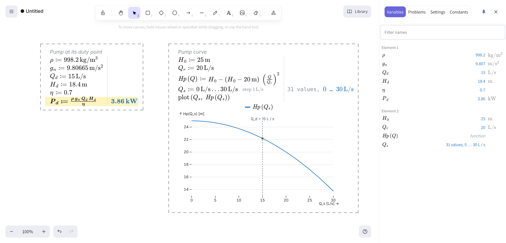

<p align="center">
  <strong>Excalimathpad</strong><br>
  A Mathcad-style live-calculation canvas built on Excalidraw: sketch freely, and put unit-aware math on the sheet that recalculates as you edit.
</p>

<h4 align="center">
  <a href="https://excalimathpad.pages.dev">Open the app</a> |
  <a href="docs/spec-v1.md">v1 spec</a> |
  <a href="CONTEXT.md">Module map</a> |
  <a href="docs/adr/">Decisions (ADRs)</a>
</h4>

<p align="center">
  <a href="https://github.com/matheus-sancha/excalimathpad/actions/workflows/ci.yml"></a>
  <a href="LICENSE"></a>
  <a href="CONTRIBUTING.md"></a>
  
  
  
</p>

<p align="center">
  
</p>

---

**Excalimathpad** is a browser-only calc sheet: the [Excalidraw](https://github.com/excalidraw/excalidraw) whiteboard with a layer of live, unit-aware math on top, in the style of Mathcad. You place math elements wherever you want them on the canvas, type one statement per line, and see each line typeset with its result and unit. Edit an input and everything below it recalculates. Drawings, notes and arrows live on the same sheet as the math.

It wraps the official `@excalidraw/excalidraw` component, never a fork ([ADR 0001](docs/adr/0001-wrap-excalidraw-unforked.md)), and evaluates with [math.js](https://mathjs.org) entirely on the client. There is no server: the app builds to static files and saves sheets to files on your own disk.

> **Status:** v1 is in progress, built in milestones (see [Roadmap](#roadmap)). M1 to M4c are built; printing (M5) and the installable offline app (M6) are next. v1 targets **Chrome and Edge on desktop**.

## Table of Contents

- [Features](#features)
- [Quick Start](#quick-start)
- [Writing a Sheet](#writing-a-sheet)
- [Keyboard Shortcuts](#keyboard-shortcuts)
- [Scripts](#scripts)
- [Build and Deploy](#build-and-deploy)
- [Architecture](#architecture)
- [Tech Stack](#tech-stack)
- [Roadmap](#roadmap)
- [Documentation](#documentation)
- [Contributing](#contributing)
- [License](#license)

## Features

### Live, unit-aware math
- **Recalculates as you type.** The whole sheet re-evaluates on every keystroke.
- **Reads like Mathcad.** Elements are read top to bottom, then left to right, in one shared scope: each line sees only what is defined above it ([ADR 0003](docs/adr/0003-sheet-evaluates-in-reading-order-in-one-scope.md)).
- **Units throughout.** You can write `15 L/s`, `102.3 mm` or `1.002 cP`, and dimensions are checked.
- **Unit systems.** Results show in SI with prefixes, SI base, USCS, or a custom kind → unit table.
- **Chosen units.** `in kPa` at the end of a line picks the unit for that result, and you can also pick one from the result's **unit slot**.
- **Constants.** All built-in physical constants are available, with Mathcad's short names (`c`, `k`, `R`, `h`).
- **Clear problems.** Errors and warnings are written in plain words, for example "defined below" rather than "Undefined symbol". A warning also appears when a name shadows a unit.

### Typeset elements
- **Typesetting.** Each line is typeset with KaTeX as a grid of name `≔` expression, result and note.
- **Prose beside the math.** `# comment` lines, trailing `# notes` and an optional element **title** carry the explanation.
- **Line formats.** `@` words set bold, underline, a highlight and a text colour.
- **Conditional formats.** A rule such as `@text-red if v > 3 m/s` applies its format only while the condition is true.
- **Suggestions while typing.** The sheet's names, constants, functions and units are offered as you type.

### Solve, ranges, tables and plots
- **`solve` for a value.** Finds every real root in a range, using a scan followed by Brent's method.
- **`solve` for a function.** Solves from a guess on every call, and solves can call other solves.
- **Ranges.** `Q_s = 1 L/s .. 30 L/s step 1 L/s` makes a list, and any line that uses it runs once per point. `x[i]` reads one value, and `min`, `max`, `sum`, `mean` and `count` aggregate a list.
- **Tables.** `table(...)` lays the values out under the line, with a chosen unit per column.
- **Plots.** `plot(x, y1, …), mark Q_op` draws a chart with [Observable Plot](https://observablehq.com/plot/). A ⚙ popover holds the chart's settings.

### Sheet and files
- **Sheet panel.** Four tabs: **Variables**, **Problems**, **Settings** and **Constants**. Clicking a row jumps to its line.
- **Your own files.** Sheets save as `.excalimathpad` files, which are Excalidraw JSON plus one extra block ([ADR 0004](docs/adr/0004-sheet-file-is-excalidraw-json-plus-a-block.md)). Plain `.excalidraw` drawings open too.
- **Recovery copy.** Unsaved work is kept in IndexedDB and offered back on the next launch.
- **Excalidraw's own undo.** Undo covers math: one step per committed line, alongside Excalidraw's own steps.
- **Build stamp.** The last line of the ☰ menu shows which build is running.

## Quick Start

### Use it

Open **<https://excalimathpad.pages.dev>** in Chrome or Edge.

### Run it locally

Requires **Node.js** `^22.22.2 || ^24.15.0 || >=26` and **npm 10+**. The Node floor is set by jsdom, which the tests use; Vite 8 alone would accept less. Both are also declared in `package.json` `engines`.

```bash
git clone https://github.com/matheus-sancha/excalimathpad.git
cd excalimathpad
npm install
npm run dev
```

Then open [http://localhost:5173](http://localhost:5173).

## Writing a Sheet

1. Press **M**, or choose **∑ Add math** under Excalidraw's **More tools**, then click the canvas to place a math element.
2. Type `R = 10 kohm`, then press **Enter** and type `I = 2 mA`.
3. Place a second element **below** the first and type `U = I * R`. It shows `20 V`.
4. Edit `I`. `U` updates at once.

An element left with no text is removed when you leave it.

### Line forms

| Form | Example | Shows |
|---|---|---|
| Comment line | `# Water at 20 C` | Text across the row |
| Plain input | `D = 102.3 mm` | The typeset input |
| Assignment | `v_d = Q_d / A_p` | Its value and unit |
| Bare expression | `2 * pi` | Its value |
| Function | `Hp(Q) = H_0 - (H_0 - H_r) (Q/Q_r)^2` | Nothing, unless it has a problem |
| Solve, value | `Q_op = solve Hp(Q) = Hs(Q), for Q = 1 L/s .. 30 L/s` | Every root found in the range |
| Solve, function | `f(Re, r) = solve …, guess f = 0.02` | Nothing, unless it has a problem |
| Range | `Q_s = 1 L/s .. 30 L/s step 1 L/s` | A list summary |
| Table | `table(Q_s, Hs(Q_s), Hp(Q_s))` | Rows under the line |
| Plot | `plot(Q_s, Hs(Q_s), Hp(Q_s)), mark Q_op` | A chart under the line |

Any line with code can end with `in <unit>`, then a format clause, then a `# note`, in that order:

```text
dP_pipe = f_d * (L_p/D) rho v_d^2 / 2 in kPa @bold @text-red if dP_pipe > 50 kPa # friction only
```

Things to know:

- **Assignment is plain `=`.** Mathcad's `:=` is not accepted. One line holds one statement.
- **Don't name variables after units** (`V`, `A`, `m`, `s`, `L`). The name shadows the unit for every line below it. The app warns when this happens.
- **A name directly before `(` is a function call** in math.js. Write `f_d * (L_p/D)`, not `f_d (L_p/D)`.

The full grammar, including every format word and every message, is in [spec section 3](docs/spec-v1.md#3-sheet-lines-every-form). A complete worked example is the [pump-sizing acceptance sheet](docs/acceptance/pump-sizing.md).

## Keyboard Shortcuts

| Keys | Action |
|---|---|
| **M** | Add math: click the canvas to place an element. **Esc** cancels |
| Double-click a line | Edit that line |
| **Enter** on a selected element | Edit its last line |
| **↑ / ↓** | Move between lines (↑ on the first line edits the title) |
| **Enter** / **Backspace** at the start | Split the line / join it to the line above |
| **Tab**, **↓ ↑**, **Enter** | Accept a suggestion while typing |
| **Esc** | Leave the line. Press it again to deselect |
| **Ctrl+B / I / U** | Bold, italic or underline in a title |
| **Ctrl+Z** / **Ctrl+Shift+Z** | Undo / redo, one committed line at a time |
| **Ctrl+D** | Duplicate an element with the same source |
| **Ctrl+S** / **Ctrl+Shift+S** | Save / Save as `.excalimathpad` |
| **Ctrl+O** | Open a sheet (or drop the file on the canvas) |

## Scripts

| Command | Description |
|---|---|
| `npm run dev` | Start the dev server at `http://localhost:5173` |
| `npm run build` | Type-check, then make a production build in `dist/` |
| `npm run preview` | Serve `dist/` locally to check the build |
| `npm run lint` | Lint with oxlint |
| `npm test` | Run the tests once with Vitest (jsdom) |
| `npm run test:watch` | Run the tests in watch mode |
| `npm run typecheck` | Run the TypeScript project build, with no output files |
| `npm run check` | Run lint, the tests and the build. **This is what CI runs** |

## Build and Deploy

`dist/` is plain static files with relative asset URLs. You can serve it from any static host or sub-path: GitHub Pages, Netlify, an S3 bucket or a local folder server. There is no backend.

### The hosted build

A push to `main` that passes `npm run check` publishes that run's `dist/` to Cloudflare Pages, through the `deploy` job in [`.github/workflows/ci.yml`](.github/workflows/ci.yml). Pull requests deploy nothing. The job is skipped until the repository has:

- the Actions **variable** `CLOUDFLARE_PAGES_PROJECT`, the name of the Pages project. It must be a direct-upload project, created in Cloudflare first;
- the Actions **secrets** `CLOUDFLARE_API_TOKEN` (with permission to edit Pages) and `CLOUDFLARE_ACCOUNT_ID`.

To check the two secrets from a terminal:

1. Set them as environment variables.
2. Run `npx wrangler@4 pages project list`. It should list the project.

`wrangler whoami` fails with a token that can only edit Pages, so it is not a useful check.

The ☰ menu's last line shows the build stamp: the short commit and date (`389dd51 · 2026-11-12`), or `dev` for a build made outside CI.

## Architecture

Excalimathpad is a **non-destructive wrapper**. Excalidraw owns the scene, selection, moving and undo. Each math element is anchored to an ordinary Excalidraw rectangle that stores its source in `customData` ([ADR 0002](docs/adr/0002-math-elements-anchor-to-excalidraw-rectangles.md)). The math is drawn in an overlay above the canvas.

```
src/
├── main.tsx          Entry: mounts App
├── App.tsx           Composition root: wires the file, canvas, overlay and panel
├── shell/            Full-viewport layout: canvas, overlay and side-panel slots
├── canvas/           Everything that knows Excalidraw: anchors, Add math, the ☰ menu,
│                     More tools items, sizes, selection, scene (de)serialisation
├── math/             The engine: evaluateSheet(blocks) → one result per line.
│                     The only module that imports math.js. Units, solve, lists,
│                     tables, plots, typesetting to TeX
├── overlay/          Typeset grids over the canvas, the line edit, gestures,
│                     unit slot, suggestions, hover tips, plot drawing
├── panel/            Sheet panel tabs: Variables, Problems, Settings, Constants
├── file/             The .excalimathpad file: save, open, recovery copy, migrations
└── test/             jsdom stubs and helpers for tests against real Excalidraw
```

### How it works

1. **Anchor.** Placing a math element creates an Excalidraw rectangle tagged `customData.kind = "math"`. Its `customData.source` is the only stored copy of the math.
2. **Reading order.** On every change, the overlay sorts the anchors top to bottom, then left to right.
3. **Evaluation.** `evaluateSheet` runs every line in one fresh scope. It never throws, and a failed line does not stop the lines after it.
4. **Overlay.** Each element is drawn over its anchor's scene position as a KaTeX grid, and the anchor's size is kept equal to the grid's. These size writes and style restorations add no undo step.
5. **Line commit.** Leaving an edited line writes the element's whole source once, as one undo step on Excalidraw's own stack.
6. **File.** The scene is saved as Excalidraw JSON plus an `excalimathpad` block for settings and the format version. Older files are upgraded on open, and files from a newer version are refused.

The full module map, interfaces and invariants are in [CONTEXT.md](CONTEXT.md). The decisions behind them are in [`docs/adr/`](docs/adr/).

## Tech Stack

| Concern | Library | Why |
|---|---|---|
| Whiteboard | [`@excalidraw/excalidraw`](https://www.npmjs.com/package/@excalidraw/excalidraw) 0.18 | The canvas, tools, selection and undo, wrapped and never forked |
| Evaluation and units | [math.js](https://mathjs.org) 15 | Safe expression parsing with a full unit system. The app closes every route an expression could use to change the shared instance |
| Typesetting | [KaTeX](https://katex.org) 0.16 | Fast, synchronous TeX to HTML, loaded lazily |
| Plots | [Observable Plot](https://observablehq.com/plot/) 0.6 | Declarative SVG charts, loaded only when a sheet has a plot |
| UI | React 19 | Matches Excalidraw's own stack |
| Build | Vite 8 + TypeScript 6 | Fast HMR and a static build with relative URLs |
| Quality | Vitest 5 (jsdom), Testing Library, oxlint | Tests run against the real Excalidraw component |
| Hosting | Cloudflare Pages | Deployed by CI from the exact build that passed |

## Roadmap

- [x] **M0 Spike.** Live recalculation across math elements.
- [x] **M1 Keepable sheet.** Typeset lines, line-by-line editing, undo, save and open, recovery copy.
- [x] **M2 Units & panel.** App units, number format, unit systems, display units, warnings, the Sheet panel, the unit slot.
- [x] **M3 Solve.** Solve for a value, solve functions, nested solves, solve details on hover.
- [x] **M4 Ranges & plots.** Ranges and lists, tables, plots, plot settings.
- [x] **M4b Hosted build.** Deployed to Cloudflare Pages on merge, with a build stamp.
- [x] **M4c Improvements.** Range solve for every root, indexing, text colours, conditional formats, chosen width, title format.
- [ ] **M5 Print.** Print the sheet to clean PDF pages.
- [ ] **M6 Offline PWA.** Install the app, work offline, open a `.excalimathpad` file from the desktop.

**v1 is done** when three things hold:

1. The [pump sheet](docs/acceptance/pump-sizing.md) passes every step.
2. The installed PWA opens a `.excalimathpad` file and works offline.
3. The sheet has been used for one real calculation other than the pump sheet.

What v1 deliberately leaves out is listed in [spec section 1](docs/spec-v1.md#1-what-v1-is-and-what-it-isnt).

## Documentation

| Document | What it says |
|---|---|
| [`docs/spec-v1.md`](docs/spec-v1.md) | What v1 **will be**. Behaviour doesn't change without this file changing |
| [`CONTEXT.md`](CONTEXT.md) | What the code **is today**: the module map, terms and invariants |
| [`docs/adr/`](docs/adr/) | **Why**: the decisions that are hard to reverse |
| [`docs/research/`](docs/research/) | Investigations behind the decisions (units, solvers, undo, printing, PWA) |
| [`docs/acceptance/`](docs/acceptance/) | The acceptance sheet and its independent reference calculation |

## Contributing

Bug reports, ideas and pull requests are welcome. See [CONTRIBUTING.md](CONTRIBUTING.md) for the workflow, the checks, and how the spec, CONTEXT.md and ADRs are kept in step with the code.

- Found a bug or missing something? [Open an issue](https://github.com/matheus-sancha/excalimathpad/issues).
- Please read the [Code of Conduct](CODE_OF_CONDUCT.md) before taking part.

## License

[MIT](LICENSE) © Excalimathpad Contributors.

Excalimathpad builds on [Excalidraw](https://github.com/excalidraw/excalidraw) (MIT), [math.js](https://github.com/josdejong/mathjs) (Apache-2.0), [KaTeX](https://github.com/KaTeX/KaTeX) (MIT) and [Observable Plot](https://github.com/observablehq/plot) (ISC). Thank you to their authors and contributors.
