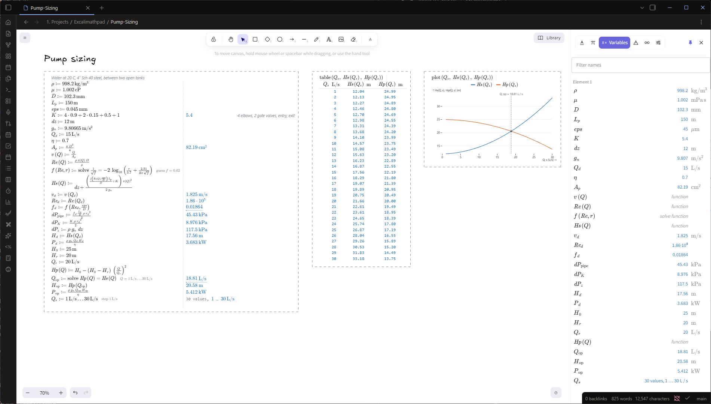
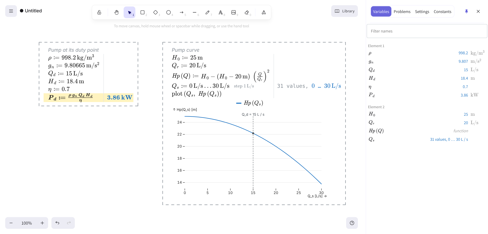

# Excalimathpad

Open and edit .excalimathpad calc sheets: an Excalidraw whiteboard with live, unit-aware math that recalculates as you edit. Works fully offline; makes no network requests.

  

You place math elements wherever you want them on the sheet, type one statement per line, and see each line typeset with its result and unit. Edit an input and every line below it recalculates. Drawings, notes and arrows live on the same sheet as the math.

## Get it

- **In Obsidian:** open **Settings → Community plugins → Browse**, search for **Excalimathpad**, then **Install** and **Enable**. It needs Obsidian 1.7.2 or later. Your sheets are `.excalimathpad` files in your vault.
- **In the browser:** open **<https://excalimathpad.pages.dev>** in Chrome or Edge on desktop. Your sheets save as `.excalimathpad` files on your disk.

  

Both read and write the same file, so a sheet moves between them as it is.

## Your first sheet

1. **Start a sheet.** In Obsidian, choose **New sheet** from the command palette, the ribbon icon or a folder's menu. In the browser, the app opens on an empty sheet.
2. **Place math.** Press **M**, or open Excalidraw's **More tools** and choose **∑ Add math**, then click the sheet where the math should go. On a phone or tablet, tap More tools, then Add math, then tap the sheet.
3. **Type.** Type `R = 10 kohm` and press **Enter**, then `I = 2 mA`, **Enter**, and `U = I * R`. It shows `20 V`.
4. **Change an input.** Press **Esc**, double-click the `I` line, change it to `I = 3 mA`, and watch `U` become `30 V`.
5. **Keep it.** In Obsidian the sheet saves itself, as notes do. In the browser, press **Ctrl+S**.

## Math guide

Every line form, unit, setting, key and message is in the **[Math guide](docs/math-guide.md)**, with examples you can type as they are. It is also in the app, under **☰ → Math guide**, offline and in Obsidian too.

A complete worked example is the [pump-sizing sheet](docs/acceptance/pump-sizing.md).

## Privacy

**In Obsidian:**

- **No network requests.** The plugin loads nothing from the internet and sends nothing to it. Every font is inside the plugin, embeds are off, and a link on the sheet opens your browser only when you click it.
- **No telemetry and no account.**
- **Nothing outside your vault.** Your sheets are files in the vault. The plugin's own memory (whether the panel is open, and light or dark) is in its `data.json`, through Obsidian.
- **It reads only what you open.** The plugin reads only the sheet open in its tab and an image you pick to place on it. It writes only that sheet, its `data.json`, the new sheets you create and a conflict copy when sync changes a sheet you are editing. It never lists, renames or deletes another note.

**In the browser:**

- The web app is static files, fonts included, served from `excalimathpad.pages.dev`. It has no telemetry and no account, and it sends your sheets nowhere.
- Your sheets save as files on your own disk. While a sheet has unsaved changes, the browser keeps a recovery copy of it in its own IndexedDB, on your computer.
- An embed you add to a sheet, such as a YouTube video, loads from its own site, as in Excalidraw.

## Support

Excalimathpad is free and best effort. There is no response time, and the roadmap follows the needs of its author's own engineering work.

- **Something wrong?** [Report a bug](https://github.com/matheus-sancha/excalimathpad/issues/new?template=bug.yml) with the version, where you use it, your device and the steps. Attach a sheet only if it holds nothing confidential: issues are public.
- **Missing something?** [Suggest an idea](https://github.com/matheus-sancha/excalimathpad/issues/new?template=idea.yml).
- **A security problem?** Please don't open an issue. Report it privately, as [SECURITY.md](SECURITY.md) explains.

## Contributing

Pull requests are welcome. [CONTRIBUTING.md](CONTRIBUTING.md) covers running it locally, the checks, the architecture and releases. What v1 will be is in the [spec](docs/spec-v1.md), what the code is today in [CONTEXT.md](CONTEXT.md), and why in the [decision records](docs/adr/). Please read the [Code of Conduct](CODE_OF_CONDUCT.md) before taking part.

## Licence and credits

[MIT](LICENSE) © Excalimathpad Contributors.

Excalimathpad builds on [Excalidraw](https://github.com/excalidraw/excalidraw) (MIT), [math.js](https://github.com/josdejong/mathjs) (Apache-2.0), [KaTeX](https://github.com/KaTeX/KaTeX) (MIT), [Observable Plot](https://github.com/observablehq/plot) (ISC) and [React](https://github.com/facebook/react) (MIT). The plugin's `main.js` carries the licence notice of every library bundled in it, at its end. Thank you to their authors and contributors.
