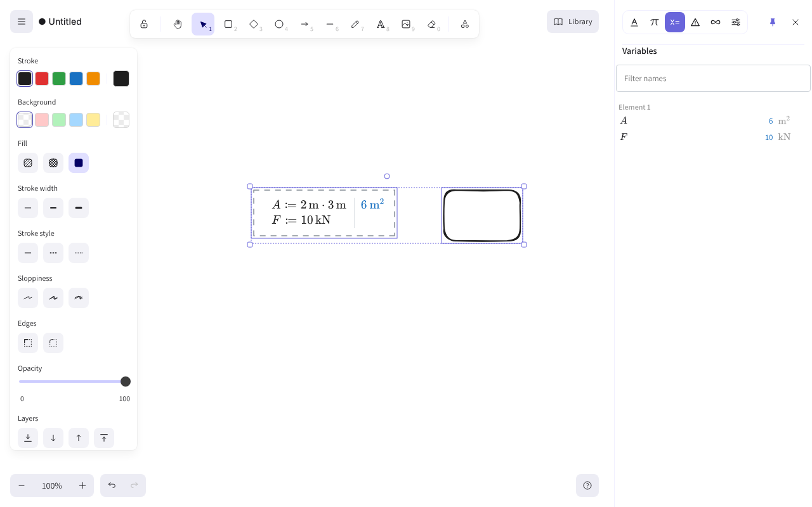
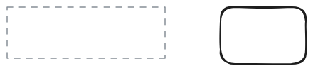

Research for wayfinder ticket #231, 2026-11-20.

# What does each of the nine Excalidraw items the testers listed need?

The nine items are from [Ideas from week 1](https://github.com/matheus-sancha/excalimathpad/issues/228):
sticky notes, web embed, draw to shape, bucket fill, lasso selection, live collaboration, Print
changed to Export, Excalidraw's preferences and language select. This note says what each one is in
Excalidraw and what Excalimathpad would need to offer it. It recommends nothing: sorting them is
the next ticket's.

## How each fact is marked

- **[P]** read from the installed package, `@excalidraw/excalidraw` **0.18.1**: its bundle and the
  TypeScript its source maps hold (`node_modules/@excalidraw/excalidraw/dist/dev/*.js.map`). Links
  go to the same file at Excalidraw's `v0.18.1` tag.
- **[C]** read from the **canary** package `@excalidraw/excalidraw@0.18.0-9fbeaed`, npm's `next`
  tag, published 2026-11-17, read the same way. Links go to commit `9fbeaed` of Excalidraw's
  repository, which the package's version names.
- **[R]** read from Excalidraw's repository, its documentation there (`dev-docs/`), or the npm
  registry.
- **[O]** observed by running: the export probe below, or the upgrade probe.
- **[A]** read from this repository at `c5f5ceb` (0.4.0 plus the two unit fixes): the code, the
  spec or `CONTEXT.md`.
- **[I]** inferred from the facts beside it. Nothing marked [I] was run.

## Answer

**The testers' list is excalidraw.com's own menus, item for item, and excalidraw.com runs code
that no release holds yet.** The labels match the canary's English strings exactly: "Sticky
note", "Web Embed", "Draw to shape", "Bucket fill", "Lasso selection" and "Preferences"
([`en.json`](https://github.com/excalidraw/excalidraw/blob/9fbeaed/packages/excalidraw/locales/en.json)
[C]); "Live collaboration", Preferences and the language `<select>` are items of excalidraw.com's
☰ menu
([`AppMainMenu.tsx`](https://github.com/excalidraw/excalidraw/blob/9fbeaed/excalidraw-app/components/AppMainMenu.tsx)
[R]). That the site is built from the repository's head and not from 0.18.1 is [I], from those
labels.

**There is no release after 0.18.1.** npm's `latest` is 0.18.1, published 2026-04-20; 0.18.0 was
2025-03-10. Everything newer is a canary build under the `next` tag, the last one
`0.18.0-9fbeaed` of 2026-11-17 ([registry](https://registry.npmjs.org/@excalidraw/excalidraw)
[R]). The changelog files all of it under "Unreleased"
([`CHANGELOG.md`](https://github.com/excalidraw/excalidraw/blob/9fbeaed/packages/excalidraw/CHANGELOG.md)
[R]). So "a newer release" below always means **unreleased code, installable only as a canary**.

Sorted by where each item exists:

| Where | Items |
|---|---|
| In 0.18.1 and shown in the web app today | Web embed (hidden in the plugin, by an agreed rule) |
| In 0.18.1 as a prop, with the control left to the host app | Language select |
| In 0.18.1 behind flags the app sets to false, and it draws no math | Excalidraw's export (the "Export" half of Print changed to Export) |
| Only in unreleased code (the canary) | Sticky notes, draw to shape, bucket fill, lasso selection, the Preferences menu |
| Only in excalidraw.com's own app code, with a server | Live collaboration |
| In Excalidraw+ only, or nowhere | None of the nine |

### The table

| Item | What it is in Excalidraw | Where it exists | What it costs here | Agreed rule it meets | With math elements |
|---|---|---|---|---|---|
| **Sticky notes** | A new element type, `stickynote`, and a toolbar tool (`N`): an always-filled note whose label shrinks to fit, with its creation date in a footer [C][R] | Not in 0.18.1: the bundle has no `stickynote` [P]. In the canary [C]; merged 2026-09-06, Unreleased [R]. The nearest thing in 0.18.1 is text typed into a rectangle [P] | An Excalidraw upgrade to unreleased code. A new element type in the sheet file: a build on 0.18.1 drops an element whose type it doesn't know when it opens the file [P] | Section 2's invariant that the app never opens a file whose `format` is newer than its own: a type an older build can't read is that case [A][I] | A drawing like any other, never an anchor [A]. Drawn on Excalidraw's canvas, so under the math [A][I]. `N` doesn't collide with `M` [C] |
| **Web embed** | The `embeddable` element: an iframe of a link from a list of hosts (YouTube, Vimeo, Figma and others) [P] | In 0.18.1. The web app's More tools shows "Web Embed" today [O]. The plugin hides it and refuses every link (`validateEmbeddable={false}`) [A] | Web: nothing, it is there. Plugin: taking the hiding off, which means network requests from the vault | Plugin: section 12a's "No network, ever", which names Excalidraw's embeds; section 1's "Not in v1" (Platforms); section 2's invariant; the bundle audit's allowlist; the listing's "makes no network requests" [A] | Math paints over an embed and takes the clicks where they overlap: the two share a z-index, accepted "while sheets have none" (`CONTEXT.md`, Load-bearing) [A] |
| **Draw to shape** | The `autoshape` tool (Shift+X): a freehand stroke is recognised and replaced by a rectangle, diamond, ellipse, line or arrow; a line that joins a shape becomes a bound arrow [C] | Not in 0.18.1 [P]. In the canary [C]. The changelog has no entry for it [R] | An Excalidraw upgrade to unreleased code | None names it; the upgrade's own rules apply (below) | It only adds elements. A recognised rectangle carries no `customData.kind`, so it is a drawing, not a math element [C][A][I]. Its arrows bind to any shape, an anchor included [I], and a bound arrow's end doesn't follow a size write (#44) [A] |
| **Bucket fill** | The `bucketfill` tool (`B`): a click fills the region the visible strokes around it enclose, by adding a strokeless filled polygon (a `line` element); a click on such a fill restyles it [C] | Not in 0.18.1 [P]. In the canary [C]. No changelog entry [R] | An Excalidraw upgrade to unreleased code | Section 4's fixed anchor style [A] | It never restyles a rectangle, so an anchor's fixed style isn't touched [C]. An anchor has a visible dashed stroke, so it bounds a region: a click inside a math element would add a fill the anchor's size, under the math [I]. The fill is its own element and doesn't follow when the anchor's size is rewritten [I] |
| **Lasso selection** | The `lasso` tool: a freehand loop selects what it encloses or crosses; locked elements are skipped [C] | Not in 0.18.1: the bundle has no `"lasso"` [P]. In the canary: in More tools, by clicking the active selection tool, and as a Preferences item [C][R] | An Excalidraw upgrade to unreleased code | None names it | Anchors are rectangles and would be selected like any other, a locked one skipped, as the marquee does [I]. It sets the same selection the app's gestures read [I] |
| **Live collaboration** | On excalidraw.com, a room: a socket.io connection to a relay server carries encrypted scene updates and pointers, and Firebase keeps the room's scene and files [R] | Only in excalidraw.com's app code [R]. The package holds the hooks and a button, no transport: `isCollaborating`, `onPointerUpdate`, `updateScene({ collaborators })`, `reconcileElements`, `<LiveCollaborationTrigger>` [P][R] | A server (a relay and storage), the client code, and hosts to reach | "Single-user, browser-only… there is no server" (`CONTEXT.md`); "Static-only build" (Load-bearing); section 12a's "No network, ever" and "no account"; section 8 leaves Excalidraw's collaboration items out [A] | A line's source is in the anchor's `customData`, so it would travel with the scene [I]. Results are computed in each browser, the sheet's settings are in the file's block and not in the scene (ADR 0004), and every client writes anchor sizes [A][I]. None of this was run |
| **Print changed to Export** | Excalidraw's "Export image…" dialog (PNG, SVG or the clipboard; only selected, background, dark mode, embed scene, scale) and its export functions [P] | In 0.18.1, behind `UIOptions.canvasActions.saveAsImage` and `export`, which the app sets to false [P][A]. "Copy to clipboard as PNG" is still in the context menu [O]. The canary replaces the three export functions by one, `exportScene` [R] | App-side work that no prop gives: Excalidraw's export draws no math [O], and the print view is a document, not a picture [A] | Section 1's "Not in v1": Excalidraw's image export (Files), printing a selection and Print on a phone or tablet (Print); section 2's "Excalidraw's own file and export actions are never reachable"; the decision in issue 221 that Print… stays as specced for 1.0.0 [A] | A math element exports as its empty dashed box [O]. See Export, below |
| **Excalidraw's preferences** | ☰ → Preferences on excalidraw.com: a submenu of twelve toggles (box selection mode, input device, tool lock, snap to objects, grid, zen mode, view mode, minimap, element properties, arrow binding, midpoint snapping, hints) [C] | `MainMenu.DefaultItems.Preferences` is in the canary only [C][P]. In 0.18.1 the canvas's right-click menu already has grid, snap to objects, zen mode, view mode and "Canvas & Shape properties" [O] | For those five: nothing, or app-side menu items over 0.18.1's props [P]. For the submenu as it is on excalidraw.com: an upgrade to unreleased code | Section 12a's storage rule (the plugin keeps its memory in `data.json` only): where a preference is remembered [A][I] | Not run. A grid for math is its own open issue, "1.1: A grid, and math elements aligned to it" [A] |
| **Language select** | On excalidraw.com, a `<select>` in ☰ that sets the package's `langCode` prop [R] | The prop and the list are in 0.18.1 (`langCode`, `languages`, `useI18n`) [P][R]. The picker is the host app's: the package removed its own [R] | A prop, an app-side control, and somewhere to remember the choice. In the plugin, also the locales its build removes [A] | Section 12a's Trims ("the non-English locales… are stubbed") and the budget per file; UI text in sentence case in both homes [A] | Excalidraw's own UI would translate. The app's labels, messages and Math guide are English text in the code, with no translation layer [A][I] |

## Notes per item

### The five that need unreleased code

Sticky notes, draw to shape, bucket fill, lasso and the Preferences menu are in the canary and not
in 0.18.1. Counted in each package's development bundle: `stickynote` 0 against 29, `"lasso"` 0
against 32, `autoshape` 0 against 40, `bucketfill` 0 against 35, `labels.preferences` 0 against 2
[P][C].

- **They can't be taken one by one.** `UIOptions.tools` hides only `image`, in 0.18.1 and in the
  canary alike
  ([`types.ts`](https://github.com/excalidraw/excalidraw/blob/9fbeaed/packages/excalidraw/types.ts)
  [C]). The canary's `ui` prop takes the whole default UI off, or everything but the listed
  controls (the changelog's "Interaction and UI control" and "Minimap, zoom menu and `ui.disabled`"
  [R]); it has no switch per tool. An upgrade brings all five, and the app would hide what it
  doesn't want as it hides Web Embed in the plugin today, by CSS on a test id
  (`src/canvas/SheetCanvas.css` [A]).
- **Sticky notes.** The tool is `N`, in the toolbar; a note can be dragged out of the toolbar; each
  shows its creation date
  ([changelog, "Sticky notes"](https://github.com/excalidraw/excalidraw/blob/9fbeaed/packages/excalidraw/CHANGELOG.md),
  [`stickyNote.ts`](https://github.com/excalidraw/excalidraw/blob/9fbeaed/packages/element/src/stickyNote.ts),
  [`Tools.tsx`](https://github.com/excalidraw/excalidraw/blob/9fbeaed/packages/excalidraw/components/Tools.tsx)
  [C][R]). In 0.18.1, `restoreElement` returns nothing for a type it doesn't list, and the caller
  filters it out
  ([`restore.ts`](https://github.com/excalidraw/excalidraw/blob/v0.18.1/packages/excalidraw/data/restore.ts)
  [P]): a sheet with notes, opened in a build still on 0.18.1, would lose them unless the file's
  `format` says it is newer [I].
- **Draw to shape.** The hint reads "Draw rectangles, circles, diamonds, lines and arrows". The
  recogniser turns one stroke into one element, or leaves it as freedraw when nothing matches
  ([`convertToShape.ts`](https://github.com/excalidraw/excalidraw/blob/9fbeaed/packages/element/src/convertToShape.ts),
  [`App.drawshape.ts`](https://github.com/excalidraw/excalidraw/blob/9fbeaed/packages/excalidraw/components/App.drawshape.ts)
  [C]).
- **Bucket fill.** A fill is a new `line` element with `polygon: true`, a transparent stroke and
  the current background colour, put in its owner's groups and frame. `restyle` runs only on such
  a fill, never on a rectangle. Rectangles, diamonds, ellipses, frames, lines and freedraw with a
  visible stroke bound a region
  ([`App.bucketFill.ts`](https://github.com/excalidraw/excalidraw/blob/9fbeaed/packages/excalidraw/components/App.bucketFill.ts),
  [`bucketFill.ts`](https://github.com/excalidraw/excalidraw/blob/9fbeaed/packages/element/src/bucketFill.ts)
  [C]). An anchor is a rectangle with a thin dashed grey border (`CONTEXT.md`, Anchor style [A]),
  so it qualifies [I].
- **Lasso.** The selection is the elements the path encloses or crosses, without locked elements
  and without text bound to a container
  ([`lasso/utils.ts`](https://github.com/excalidraw/excalidraw/blob/9fbeaed/packages/excalidraw/lasso/utils.ts)
  [C]).
- **Preferences.** The twelve items are in
  [`DefaultItems.tsx`](https://github.com/excalidraw/excalidraw/blob/9fbeaed/packages/excalidraw/components/main-menu/DefaultItems.tsx)
  [C]; 0.18.1's file has no `Preferences`
  ([`DefaultItems.tsx`](https://github.com/excalidraw/excalidraw/blob/v0.18.1/packages/excalidraw/components/main-menu/DefaultItems.tsx)
  [P]). Several of the twelve belong to things 0.18.1 doesn't have (lasso as the box selection
  mode, the input device, the minimap). 0.18.1 takes `gridModeEnabled`, `zenModeEnabled`,
  `viewModeEnabled` and `objectsSnapModeEnabled` as props
  ([`types.ts`](https://github.com/excalidraw/excalidraw/blob/v0.18.1/packages/excalidraw/types.ts)
  [P]). The web app's canvas menu, read in the probe: Paste, Copy to clipboard as PNG, Copy to
  clipboard as SVG, Select all, Toggle grid, Snap to objects, Zen mode, View mode, Canvas & Shape
  properties [O]. The plugin's canvas menu wasn't read. How zen mode and view mode behave with the
  line edit and the Sheet panel wasn't run.

### What an upgrade to the canary breaks: the upgrade probe [O]

A clone of this repository at `c5f5ceb`, with `@excalidraw/excalidraw` set to `0.18.0-9fbeaed`
and **no other change**:

| Step | 0.18.1 (CI) | Canary |
|---|---|---|
| `tsc -b` | passes | 50 errors in 9 files |
| `vitest run` | passes | 351 of 2,196 tests fail, in 26 of 86 files |
| `node esbuild.plugin.mjs` | builds | fails: no `restore`, no `exportToSvg` |
| Bundle audit | passes | nothing to audit |

Most of the failures have one cause: the `excalidrawAPI` prop was renamed `onExcalidrawAPI`, so
the app never gets its handle and every test that mounts Excalidraw fails. The numbers show that
the canary isn't a drop-in, not how much work an upgrade is. The causes the type-check names, each
a breaking change in the changelog's Unreleased section [R]:

| What changed in the canary | Where the app uses it [A] |
|---|---|
| `excalidrawAPI` prop renamed `onExcalidrawAPI` | `src/canvas/SheetCanvas.tsx` |
| `scrollToContent` replaced by `setViewport` | `src/canvas/selection.ts`, `src/canvas/sceneFile.ts` |
| `exportToSvg` replaced by `exportScene` | `src/canvas/printScene.ts`: the drawings on every printed page |
| `restore` no longer exported (`restoreElements` is) | `src/canvas/sceneFile.ts`: opening a sheet |
| `appState.editingLinearElement` gone | `src/canvas/anchorSize.ts` (`sizeWritesWait`), `src/overlay/useSheetGestures.ts` |
| `MainMenu.DefaultItems.ToggleTheme` needs `allowSystemTheme` | `src/canvas/SheetCanvas.tsx` |

The contracts `CONTEXT.md` pins to 0.18.1's text, and what the changelog and the canary say about
each. None was re-run past the failures above:

- **The toolbar.** Tool buttons are now `<button>`s with `aria-pressed`; `.ToolIcon_type_radio`
  and the hidden radios are gone; the image tool moved into More tools on a desktop [R]. The app's
  image tool finds a radio inside `label.ToolIcon` (`src/canvas/imageTool.ts`), and its own items
  are drawn into the More tools dropdown's box (`moreTools.excalidraw.test.tsx`) [A].
- **`writeAnchorSource`'s capture.** `CONTEXT.md` already says upstream dropped the version
  comparison it relies on, "so this has to change at the next Excalidraw upgrade" [A].
- **The pop-out bridge, the plugin's trims and rewrites, the layers.** Each is tied to 0.18.1's
  text (`CONTEXT.md`, Load-bearing [A]). The plugin's build stopped before its trims ran, so they
  weren't tested. The canary also brings `@excalidraw/mermaid-to-excalidraw` 3.6.0 in place of
  2.2.2, and three new packages (`@excalidraw/common`, `element`, `math`)
  ([`package.json`](https://github.com/excalidraw/excalidraw/blob/9fbeaed/packages/excalidraw/package.json)
  [C]); the plugin's size against its budget wasn't measured.
- **A key the canary adds that reaches an anchor.** Tab on a selected rectangle, diamond or
  ellipse opens a shape switch, and a second Tab converts the element to the next type, keeping
  its other fields
  ([`App.tsx`](https://github.com/excalidraw/excalidraw/blob/9fbeaed/packages/excalidraw/components/App.tsx),
  [`ConvertElementTypePopup.tsx`](https://github.com/excalidraw/excalidraw/blob/9fbeaed/packages/excalidraw/components/ConvertElementTypePopup.tsx)
  [C]). The app reads an element as a math anchor only while its type is `rectangle`
  (`isMathAnchor`, `src/canvas/mathAnchor.ts` [A]), so a converted anchor would stop being a math
  element [I]. The line's field takes Tab while a line is open; a selected element with no open
  line doesn't [I].
- **Letter keys.** The canary adds `N` (sticky note), `B` (bucket fill) and Shift+X (draw to
  shape); none is `M`
  ([`Tools.tsx`](https://github.com/excalidraw/excalidraw/blob/9fbeaed/packages/excalidraw/components/Tools.tsx)
  [C]).

A canary is a build of whatever was merged that day, and the API is still moving: the changelog
notes that "most, if not all, `excalidrawAPI.on*` subscriptions will be removed" in future
releases [R].

### Web embed

In 0.18.1 the tool is one item of More tools, and a link is accepted when `validateEmbeddable`
allows it; left unset, a list of hosts decides (YouTube, Vimeo, Figma, link.excalidraw.com, GitHub
gists, X, simplepdf, StackBlitz, val.town, Giphy, Reddit)
([`Actions.tsx`](https://github.com/excalidraw/excalidraw/blob/v0.18.1/packages/excalidraw/components/Actions.tsx),
[`embeddable.ts`](https://github.com/excalidraw/excalidraw/blob/v0.18.1/packages/excalidraw/element/embeddable.ts)
[P];
[the prop's documentation](https://github.com/excalidraw/excalidraw/blob/9fbeaed/dev-docs/docs/%40excalidraw/excalidraw/api/props/props.mdx)
[R]). App passes `embeds={!vault}`, and `SheetCanvas` turns that into
`validateEmbeddable={embeds ? undefined : false}` [A]. The web app's More tools, read in the
probe: Frame tool, Web Embed, Laser pointer, Mermaid to Excalidraw, Add math, Math settings [O].
So the testers, on the plugin, asked for something the web app has and the plugin leaves out on
purpose. How an embed prints wasn't checked.

### Live collaboration

excalidraw.com's client is
[`excalidraw-app/collab/Collab.tsx`](https://github.com/excalidraw/excalidraw/blob/9fbeaed/excalidraw-app/collab/Collab.tsx)
and
[`Portal.tsx`](https://github.com/excalidraw/excalidraw/blob/9fbeaed/excalidraw-app/collab/Portal.tsx):
it opens a socket.io connection to `VITE_APP_WS_SERVER_URL`, which production sets to
`https://oss-collab.excalidraw.com`
([`.env.production`](https://github.com/excalidraw/excalidraw/blob/9fbeaed/.env.production)),
encrypts what it sends with the room's key, saves the scene to Firebase and merges what arrives
with `reconcileElements`. Its dependencies are `socket.io-client` and `firebase`
([`excalidraw-app/package.json`](https://github.com/excalidraw/excalidraw/blob/9fbeaed/excalidraw-app/package.json)).
The relay is a separate project, [excalidraw-room](https://github.com/excalidraw/excalidraw-room),
"Example of excalidraw collaboration server" [R]. The package's own part is a button:
"If you implement live collaboration support and want to expose the same UI button as on
excalidraw.com, you can render the `<LiveCollaborationTrigger/>` component"
([documentation](https://github.com/excalidraw/excalidraw/blob/9fbeaed/dev-docs/docs/%40excalidraw/excalidraw/api/children-components/live-collaboration-trigger.mdx)
[R]).

### Language select

- `langCode` is a prop, default `en`
  ([documentation](https://github.com/excalidraw/excalidraw/blob/9fbeaed/dev-docs/docs/%40excalidraw/excalidraw/api/props/props.mdx)
  [R]); `languages`, `defaultLang` and `useI18n` are exported
  ([`index.tsx`](https://github.com/excalidraw/excalidraw/blob/v0.18.1/packages/excalidraw/index.tsx)
  [P]). The package removed its own picker: "It is now the host app's responsibility to implement
  a language picker" (changelog, #2644 [R]). excalidraw.com's is 27 lines
  ([`LanguageList.tsx`](https://github.com/excalidraw/excalidraw/blob/9fbeaed/excalidraw-app/app-language/LanguageList.tsx)
  [R]).
- 0.18.1 lists 45 languages with English and offers the ones at least 85% translated: 27 with
  English. Brazilian Portuguese is at 91% and offered; European Portuguese is at 83% and isn't
  ([`i18n.ts`](https://github.com/excalidraw/excalidraw/blob/v0.18.1/packages/excalidraw/i18n.ts)
  and its `percentages.json`, computed from the installed package [P]).
- The web build keeps every locale as a chunk fetched when it is chosen [A]. The plugin's build
  swaps every locale but English for an empty module (`esbuild.plugin.mjs`: "the plugin sets no
  language, so English (bundled) is all it reads") [A]. The installed package's 55 locale files
  are 1,648,766 bytes together and Brazilian Portuguese is 21,725. `main.js` is 3,404,028 bytes
  against its budget of 3,574,000 (`scripts/audit-plugin.mjs`), so 169,972 are free: one locale
  fits and all of them don't (measured on this session's build [A]).
- Neither `src/` nor `plugin/` uses `langCode` or `useI18n` [A]. The items the plugin hides are
  found by test id, not by their English text (`src/canvas/SheetCanvas.css` [A]), so they would
  stay hidden in another language [I]. Whether the plugin could follow Obsidian's own language
  setting wasn't checked: **unverified**.

### Export

**What Excalidraw's export draws today: the export probe [O].** The built web app (`dist/` of this
session) in headless Chromium: a rectangle and a math element with two lines, both selected, then
Excalidraw's own "Copy to clipboard as PNG" from the context menu, and the picture read back from
the clipboard.

| The sheet on screen | What was copied |
|---|---|
|  |  |

The math element comes out as its anchor's dashed border with nothing inside; the rectangle comes
out whole. The math is typeset HTML in the overlay, outside Excalidraw's canvas (ADR 0001), and
Excalidraw's export draws scene elements only. The probe is
[`probe-export.mjs.txt`](excalidraw-nine-items/probe-export.mjs.txt). This route is reachable in
0.4.0: "Copy to clipboard as PNG" is in the context menu in both homes, and "Copy to clipboard as
SVG" on the web (spec section 8, "Hidden in the plugin" [A]).

**What 0.18.1 holds.** The "Export image…" dialog offers PNG, SVG and the clipboard, with only
selected, background, dark mode, embed scene and scale
([`ImageExportDialog.tsx`](https://github.com/excalidraw/excalidraw/blob/v0.18.1/packages/excalidraw/components/ImageExportDialog.tsx)
[P]). `UIOptions.canvasActions.saveAsImage` shows or hides it, and `export` the "Save to…" dialog
([documentation](https://github.com/excalidraw/excalidraw/blob/9fbeaed/dev-docs/docs/%40excalidraw/excalidraw/api/props/ui-options.mdx)
[R]); the app sets both to false, with `loadScene` and `saveToActiveFile`, because Excalidraw's
save drops the sheet's block (`src/canvas/SheetCanvas.tsx`, ADR 0004 [A]). The functions
`exportToCanvas`, `exportToBlob`, `exportToSvg` and `exportToClipboard` are exported [P]. In the
canary the first three are one function, `exportScene`, which can also export a region (`x`, `y`,
`width`, `height`), and a host can delay a JSON export with `onExport` (changelog, "Export API"
[R]).

**What the print view could hand an export.** Print… already builds the whole sheet with its
math: `printSheet` lays the pages out, asks Excalidraw for each page's drawings as one SVG
(`exportToSvg`, the anchors left out) and puts a copy of the overlay's typeset HTML over them,
with KaTeX's fonts (`docs/context/print.md`, `src/canvas/printScene.ts` [A]). What it produces is
DOM for the browser's print dialog: paged, with a footer, sized to the paper. A PDF comes from the
dialog's own "Save as PDF", which is what the print run reads [A]. Nothing in the app turns that
DOM into a PNG or an SVG, and nothing in Excalidraw's export takes HTML [A][P]. So a picture of a
sheet with its math needs a route that doesn't exist yet: the print view supplies the layout and
the math's HTML, and something has to rasterise it [I].

**Against the export issue.**
[After 1.0.0: Export a selected area as an image](https://github.com/matheus-sancha/excalimathpad/issues/221)
already names that missing route as its first open question ("the route that draws typeset math
into a picture, verified in the built plugin with the network blocked before anything is built on
it") and records the decision of 2026-11-16 that Print… stays as specced for 1.0.0 with the area
export after it. The testers' item, "Change from Print to Export (using the developed print and
Excalidraw export method)", asks for the same two parts put together, for the whole sheet rather
than an area. Whether it is one piece of work with that issue or two is the sorting ticket's.

## Not checked

- None of the canary's features was run in this app: the app doesn't start on the canary without
  code changes. Every "with math elements" cell for a canary-only item is [I] from the canary's
  source and this repository's.
- That excalidraw.com serves the repository's head.
- Excalidraw+. None of the nine needed it to be located.
- The plugin's canvas menu; how an embed prints; zen mode and view mode with the line edit; the
  plugin's size on the canary; Obsidian's language setting.
